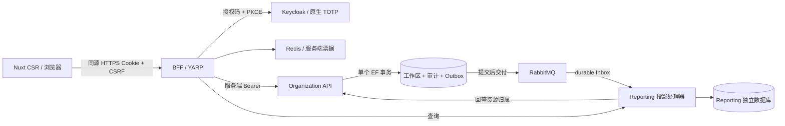

# P1 首个工作区切片

日期：2026-11-06。状态：本地 Debug / Release 与真实浏览器切片通过，P1 整体仍在进行。远端 CI、生产部署和完整 AccountGo 功能尚未验收。

本文件及 `artifacts/p1/validation.json` 保留首个切片当时的范围与结果。当前实现已增加成员、邀请和统一授权；最新结果以 [成员授权增量记录](p1-membership-authorization.md) 为准。

以下涉及独立 ASP.NET Core BFF 的命令对应当时的项目结构。当前入口和运行方式见 [Nitro BFF 迁移验收](p1-nitro-bff.md)。

数据库布局后续已改为本地一个 PostgreSQL 实例、三个独立数据库与账号，见 [整合记录](postgres-consolidation.md)。本文件下述三实例描述保留为初始验收历史。

## 已实现的链路



Organization、Reporting、Keycloak 分别使用独立 PostgreSQL 实例与生成的密码。共享 broker 当前使用开发凭据；生产数据库最小权限、broker 分账户和秘密交付另行完成。Redis 丢失票据时要求重新登录。

浏览器访问 BFF，Nuxt 在其后提供页面，避免多源 Cookie / CORS 链路。access / refresh token 保存在 Redis 中的加密 AuthenticationTicket，Cookie 只有受保护的随机票据引用；DataProtection key 本地持久化到 Redis，生产 key 加密与轮换尚未验收。Cookie 使用 `__Host-`、Secure、HttpOnly；写请求校验 antiforgery。OIDC 注销可能使用标准 `id_token_hint` 前通道参数，因此不声称所有协议 token 都永远不会进入浏览器网络链路。

当前会话绑定 token 有效期，到期重新登录；未实现协调刷新或完整的管理员会话撤销。自助注册、Google、邮箱 OTP 正式 provider、恢复码产品页面和业务敏感操作 step-up 仍是 P1 必交付项。

## 领域与事务边界

- `Organization.Domain`：工作区聚合、issuer + subject 身份值对象、治理权限与纯领域事件。新建工作区同时分配新租户；本切片不支持在任意外部传入 TenantId 下创建公司。
- `Organization.Application`：用例、查询与仓储端口；不引用 Wolverine、EF 或 ASP.NET。创建者的身份取自已经验签的 JWT，客户端不能提交 Owner / TenantId。
- `Organization.Infrastructure`：Wolverine 适配器显式选择写 DbContext；仓储共享该实例。聚合写入、审计和版本化集成事件 Outbox 在同一 PostgreSQL 事务提交。
- `Organization.Contracts`：纯 `WorkspaceCreatedV1`，不共享实体或数据库。Reporting 只引用该公开契约，不引用 Organization 的私有层。
- `Reporting`：Application / Infrastructure / Api 三层只读模型，暂不建立空 Domain。业务键拒绝冲突创建事件，重复同一事件不会重复建行；读取前回查 Organization 归属，投影不是授权事实。

Owner 只有工作区治理权限，不隐含财务过账权。首个切片当时尚缺的 UserAccount、成员、统一授权端口和工作区授权版本 / 撤销，现已由 [后续增量](p1-membership-authorization.md) 补齐；自定义业务角色与完整 A0–A5 继续验收。

同一 issuer / subject + OperationId 串行重复提交返回原工作区，不再发事件；相同编号改名称返回 409。并发重复提交由数据库唯一键保证不重复创建，完整并发响应语义还需后续验收。前端写请求 `retry: 0`，结果不明确时保留当前页面中的操作编号，供手动重试；刷新页面后的操作恢复工作台尚未实现。

## 框架接线中已验证的细节

- Wolverine 6.61.0 在外部 Infrastructure 注册时显式指定 API 的 `ApplicationAssembly`，另显式扫描消息适配器程序集，避免 Alba / 入口程序集变化漏发现 HTTP 端点。
- 无外部依赖、无可变状态的 FluentValidation 校验器使用 singleton，构建前调用已核实的 `AddJasperFxEnumerableSingletonSupport()`；保持 Development 的 DI scope 校验开启。
- 独立业务 EF 迁移由各服务持有；Wolverine 消息 schema 分别为 `organization_messages`、`reporting_messages`，本地通过资源设置初始化。Development 自动执行业务迁移；生产须独立迁移作业，尚未验收。
- 已安装并实际使用 RuntimeCompilation；静态代码生成 / Production 发布、Saga、持久延时、崩溃与 Inbox 恢复尚未验收。
- Aspire Keycloak typed hosting `13.6.4-preview.1.26523.11` 采用 HTTPS，虽然集成端点名为 `http`，其实际 URL 是 `https`。客户端从端点引用构造 authority，公开 issuer 使用稳定配置 `https://localhost:8088`，不得按端点名称猜协议。
- 原 AppHost 已迁至 `src/Hosting/Nexora.AppHost`，保留 UserSecretsId；本地开发用户使用生成密码且首次强制 TOTP。导入只在 realm 不存在时生效；修改模板不等于已有 realm 已升级。
- Nuxt 在 Windows 含空格的工作区路径中，Vite 内联 checker 曾错误拆分路径；使用独立 `pnpm typecheck` 与 `pnpm build`，两者均通过，strict 保持开启。
- pnpm 12 仅批准 esbuild 的依赖构建脚本，见 `pnpm-workspace.yaml`，没有全局开放依赖脚本。[pnpm 构建脚本设置](https://github.com/pnpm/pnpm.io/blob/main/docs/settings/build.md)。

## 本地验证证据

| 检查 | 实际结果与边界 |
| --- | --- |
| `dotnet restore Nexora.slnx --locked-mode` | 通过；13 个 .NET 工程，无失效前端引用 |
| Debug / Release 构建 | 均 0 警告、0 错误 |
| xUnit / Alba / Testcontainers | Debug / Release 各 5/5；4 个领域 / 应用 / 边界用例与 1 个真实数据库 / broker 复合切片 |
| 事务与消息 | HTTP 校验 400、创建 201、重复 200、冲突 409、越权 404；真实 RabbitMQ 投影、业务事实重复去重、broker 离线时 Outbox 持久化、恢复后投影成功、审计失败整体回滚 |
| Nuxt | 固定锁安装、TypeScript strict 检查、生产构建通过 |
| Playwright / Edge | 1/1 真实完整用例：OIDC + PKCE / TOTP、服务端会话、CSRF 拒绝、创建与投影、Alice / Bob 归属隔离、Cookie 属性、浏览器存储无 token、注销后 401 |
| 桌面 / 移动视口 | 1440×1000、390×844 已截图并可视检查；移动端无水平溢出 |
| Aspire | 两个业务服务、BFF、Nuxt、Keycloak、三套 PostgreSQL、RabbitMQ、Redis 均运行验证；当前 API health 为基础存活检查，完整依赖 readiness 与遥测指标断言仍待做 |
| CI | `.github/workflows/ci.yml` 已配置；没有推送或执行远端 Actions，不能当作远端通过 |

后端组件测试使用 **仅测试用 AuthenticationStub** 隔离 OIDC，实际认证验收由独立浏览器用例完成。浏览器没有关闭 HTTPS 错误校验，使用本机受信任的开发证书。Testcontainers 重启 broker 时显式保持测试端口，避免 Docker 重新映射随机端口造成错误的恢复失败结论；端口通过本机临时监听器选取，极小概率抢占时需重新运行测试。

源码：[领域 / 应用 / 架构测试](../../tests/Nexora.Tests/DomainTests.cs)、[事务与消息切片](../../tests/Nexora.Tests/WorkspaceSliceTests.cs)、[真实浏览器用例](../../src/Web/nexora-web/e2e/workspace.spec.ts)。

产物：[脱敏检查汇总](../../artifacts/p1/validation.json)、[浏览器结果](../../artifacts/p1/browser-results.json)、[桌面截图](../../artifacts/p1/workspace-desktop.png)、[移动截图](../../artifacts/p1/workspace-mobile.png)。详细 TRX 在本地被忽略的 `artifacts/p1/test-results/`，CI 单独上传该目录；运行时 HTML / MFA 种子不上传。

## 复现

运行条件与启动命令见 [README](../../README.md)。从仓库根目录执行：

```powershell
pwsh scripts/p1/Test-Foundation.ps1
# 已启动 Aspire 并等 bff healthy 后，增加真实浏览器验证：
pwsh scripts/p1/Test-Foundation.ps1 -Browser
```

浏览器用例读取本机生成的开发 realm 密码，首次登记 TOTP，MFA 种子保存在被忽略的 runtime 目录供下次挑战使用。已有账号已登记但本机测试种子缺失时明确失败，不绕过 MFA；应使用新的独立验证身份 / realm。浏览器测试会留下其创建的工作区作为核对数据，使用独立开发库，不在真实业务库运行。

UserAccount、工作区成员 / 邀请与通用授权端口增量现已落地；剩余勾选以 [计划 TODO](../计划.md) 为准。

## 本地会话失效后的退出

2026-11-11，使用已登录的浏览器标签页模拟 BFF 会话丢失，同时保留 Keycloak 浏览器会话。修复前 `/bff/antiforgery` 返回 401，页面无法发起退出。修复后可取得与当前身份状态绑定的 CSRF 令牌并提交退出。缺少 ID token 时，OIDC 退出请求使用已注册的客户端 ID，由 Keycloak 提示确认。

已运行的 AppHost 中重建 BFF 并等待就绪。BFF Release 构建和 Nuxt 类型检查通过。两项 Playwright 用例覆盖正常退出及会话丢失后的退出。后者验证确认退出后重新登录会显示凭据页、缺少 CSRF 令牌的退出 POST 返回 400、匿名请求持有 CSRF 令牌仍不能创建工作区。

```powershell
$appHost = 'src/Hosting/Nexora.AppHost/Nexora.AppHost.csproj'
aspire resource bff rebuild --apphost $appHost --non-interactive
aspire wait bff --apphost $appHost --timeout 120 --non-interactive
dotnet build src/Gateway/Nexora.Bff/Nexora.Bff.csproj -c Release --no-restore
pnpm --dir src/Web/nexora-web typecheck
pnpm --dir src/Web/nexora-web test:e2e --grep 'after the BFF session is gone|OIDC \+ TOTP'
```

### 会话失效并刷新首页后的退出

2026-11-11，在 Edge 中完成登录，仅移除 BFF 会话 Cookie 并刷新首页。修复前页面只有登录入口。首页登录卡片新增「退出已有登录」，复用原有 CSRF 保护及 Keycloak 注销流程。

三项 Edge 用例通过，覆盖正常退出、会话失效后在原标签页退出、会话失效后刷新首页再退出。三项均验证退出后 `/bff/me` 返回 `401`，再次登录时显示 Keycloak 凭据页。会话失效用例还验证了 Keycloak 确认页与 CSRF 拒绝行为。Nuxt 类型检查退出码为 0，输出仍包含 `vue-router/volar/sfc-route-blocks` 解析警告。

```powershell
$appHost = 'src/Hosting/Nexora.AppHost/Nexora.AppHost.csproj'
aspire start --apphost $appHost --non-interactive
aspire wait bff --apphost $appHost --timeout 120 --non-interactive
pnpm --dir src/Web/nexora-web test:e2e --grep 'after the BFF session is gone|OIDC \+ TOTP'
aspire stop --apphost $appHost --non-interactive
pnpm --dir src/Web/nexora-web typecheck
```

### 退出页面 404 回归

2026-11-12，排查 `Page not found: /bff/logout`。修复前，从 Nuxt 开发端口 `3000` 请求退出接口会收到 Nuxt 的 HTML。通过 BFF 直接打开退出地址时，`GET /bff/logout` 也会进入 Nuxt。现在浏览器从开发端口自动转到 `https://localhost:7443`，直接打开退出地址会回到首页并保留会话。点击按钮会发起受 CSRF 保护的 POST，退出所需令牌缺失时留在原页面提示重试。

本地 Edge 5/5 通过，覆盖从开发端口进入 BFF、意外 HTML 响应提示、直接打开退出地址时保留会话、正常 OIDC 退出和两种会话失效场景。Release 构建零警告、零错误，后端测试 31/31 通过。Nuxt 类型检查退出码为 0，仍输出既有的 `vue-router/volar/sfc-route-blocks` 解析警告。

```powershell
dotnet build Nexora.slnx -c Release --no-restore
$appHost = 'src/Hosting/Nexora.AppHost/Nexora.AppHost.csproj'
aspire start --apphost $appHost --non-interactive
aspire wait bff --apphost $appHost --timeout 150 --non-interactive
pnpm --dir src/Web/nexora-web test:e2e --grep 'BFF entry|unexpected antiforgery|OIDC \+ TOTP|after the BFF session is gone'
aspire stop --apphost $appHost --non-interactive
dotnet test tests/Nexora.Tests -c Release --no-build
pnpm --dir src/Web/nexora-web typecheck
```

### 退出成功后隐藏备用入口

2026-11-12，BFF 验证到有效的本地会话时写入浏览器提示 Cookie。在 Keycloak 注销回调携带有效状态时清除提示。Cookie 仅记录本浏览器曾有登录会话，用于控制首页的备用退出入口。

BFF Release 构建零警告、零错误。Edge 5/5 通过，确认新浏览器只显示登录按钮，正常退出后刷新仍隐藏备用入口，会话失效后刷新仍可发起退出。Keycloak 确认前保留提示，确认并返回首页后隐藏备用入口。Nuxt 类型检查退出码为 0，仍输出既有的 Vue Router 插件解析警告。

```powershell
dotnet build src/Gateway/Nexora.Bff/Nexora.Bff.csproj -c Release --no-restore
$appHost = 'src/Hosting/Nexora.AppHost/Nexora.AppHost.csproj'
aspire resource bff rebuild --apphost $appHost --non-interactive
aspire wait bff --apphost $appHost --timeout 120 --non-interactive
pnpm --dir src/Web/nexora-web test:e2e --grep 'BFF entry|unexpected antiforgery|OIDC \+ TOTP|after the BFF session is gone'
pnpm --dir src/Web/nexora-web typecheck
```

## BFF 职责拆分回归

2026-11-11，BFF 保持单项目。组合根注册认证、请求保护和 YARP 代理。代理目标与就绪检查从同一路由表得到。

- 解决方案 Release 构建成功，零警告、零错误。启动 Linux Docker 引擎后，后端测试 31/31 通过。Aspire 的 BFF 就绪检查通过。
- 既有 Edge 用例通过会话失效后的退出、成员邀请与即时停用。按 README 补装 Finance 所需的 Chromium Headless Shell v1248 后，采购至总账及销售至总账用例复跑通过，覆盖发票 PDF 与匿名分享路由。
- 临时 Edge 检查复用开发身份与浏览器请求辅助函数，验证 OIDC / TOTP、Secure / HttpOnly Cookie、CSRF、Organization / Reporting / MasterData 转发、工作区隔离、浏览器自带 Authorization 被替换、响应包含 `no-store`、正常 OIDC 注销及退出后 401。临时用例已移除。
- 旧浏览器用例仍有两处失败。商品目录用例等待 `定义编码` 超时，原 OIDC 用例要求浏览器存储为空，与当前前端主题偏好配置不符。

```powershell
dotnet build Nexora.slnx -c Release --no-restore
dotnet test tests/Nexora.Tests -c Release --no-build
pwsh src/Services/Finance/Nexora.Finance.Api/bin/Release/net10.0/playwright.ps1 install chromium --only-shell

# 在独立验证 shell 中运行，未获准的依赖构建脚本仍跳过。
$env:PNPM_CONFIG_STRICT_DEP_BUILDS = 'false'
$appHost = 'src/Hosting/Nexora.AppHost/Nexora.AppHost.csproj'
aspire start --apphost $appHost --non-interactive
aspire wait bff --apphost $appHost --timeout 150 --non-interactive
pnpm --dir src/Web/nexora-web test:e2e --grep 'after the BFF session is gone|Workspace invitation|Purchase orders|P4 sales'
aspire stop --apphost $appHost --non-interactive
```

临时 pnpm 设置用于跳过 `vue-demi` 未获准脚本时继续安装。前端构建脚本的批准列表沿用仓库配置。[pnpm 依赖构建设置](https://pnpm.io/supply-chain-security)

### Presentation 与 Infrastructure 复测

2026-11-11，登录端点与 HTTP 请求保护迁入 `Presentation`，OIDC、Redis 会话和 YARP 代理迁入 `Infrastructure`。解决方案 Release 构建零警告、零错误，后端测试 31/31 通过，Aspire 中 BFF 就绪，会话失效后退出的 Edge 用例通过。

成员邀请用例已经通过 BFF 登录并兑换邀请。Reporting 查询在 30 秒内持续返回 `202`，服务日志显示请求到达 Reporting 并查询了投影。重启 Reporting 后的一次复测在 Keycloak 登录阶段超时，成员邀请用例本轮未通过。用例改为等待投影返回 `200`，即时停用等权限断言沿用原有条件。

复用上面的 AppHost 启停命令和临时 pnpm 设置，可用 `pnpm --dir src/Web/nexora-web test:e2e --grep 'after the BFF session is gone|Workspace invitation'` 复测。
