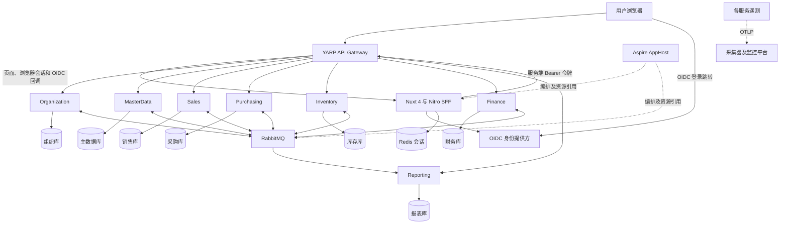
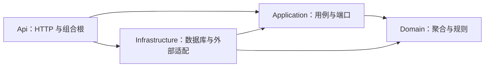
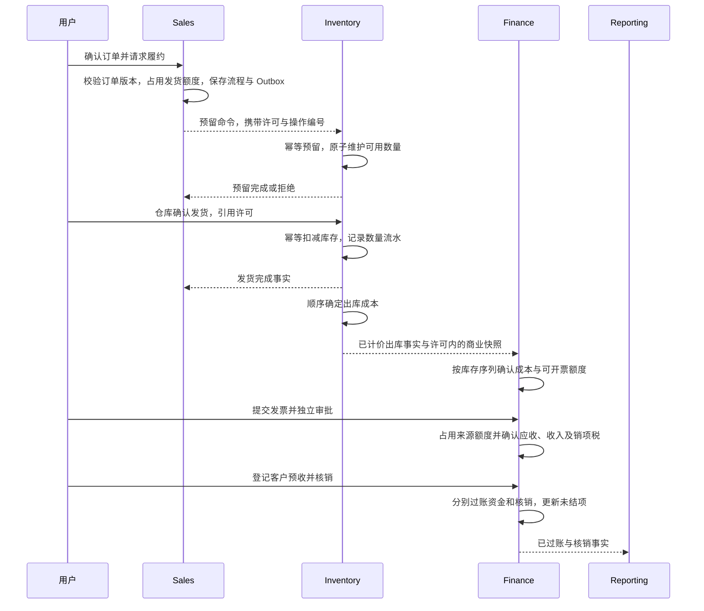

# Nexora ERP 架构设计

> 更新日期：2026-11-06  
> 状态：目标架构；P1 首个工作区切片已本地验证，其他业务能力与完整技术验收继续按计划实施。  
> 首期业务：商贸 / 批发 / 零售的进销存与财务一体化。

> 功能目标：先对齐 AccountGo 固定提交 `535c1cdff823f1eadddea10517dac81e3ba6a61a` 的公开功能基线；完整能力矩阵与验收归属见 [计划.md](计划.md)。本项目采用既定技术栈独立实现，文档覆盖不代表功能已完成。

文档分工：[架构.md](架构.md) 定义系统与领域设计；[计划.md](计划.md) 定义实施、迁移与验收；[依赖.md](依赖.md) 管理技术选型、版本和运行依赖。

P0 细化材料：[用例与状态入口](domain/p0-index.md)、[上下文 / 状态机 / 契约](domain/p0-contexts-contracts.md)、[角色权限](domain/p0-authorization.md)、[业务政策与 CNY 算例](domain/p0-policies.md)、[ADR](adr/README.md)。中国大陆 / CNY 已确认，真实税务模板及部分外部接入条件未关闭，P0 总体仍在进行。

后端：ASP.NET Core + .NET Aspire + Wolverine 全家桶 + 微服务 + Clean Architecture + 严格 DDD + CQRS。  
前端：Nuxt 4 + Vue 3 + TypeScript。

当前启用 Organization、Reporting、MasterData、Purchasing、Inventory 和 Finance 六个业务服务。Purchasing 管订单审批和收货额度，Inventory 管仓库、实际收退货与成本池，Finance 依据已计价事实及复核后的财务单据维护暂估、应付、资金与总账。网关负责业务请求的路由，Organization 提供工作区及成员权限校验。[主数据验收](verification/p2-masterdata-references.md) · [P3 端到端验收](verification/p3-purchase-to-ledger.md)

成员与授权增量已在 [ADR 0017](adr/0017-workspace-governance.md) 落地：Workspace 聚合拥有治理成员与邀请，统一应用授权端口由 HTTP policy、应用用例和 Wolverine 适配共享；新用户意图仅允许经过已认证边界的本地调用，listener 中的序列化 Actor 不构成凭据。使用权威即时查询和聚合版本防并发撤销穿透；授权变更事实只更新 Reporting 水位，不成为放行依据。内置治理角色以工作区为范围，自定义业务角色 / 多范围和敏感政策仍待完成，见 [本地验收](verification/p1-membership-authorization.md)。

## 1. 架构结论

采用 **Monorepo 中的业务微服务架构**。按业务能力划分服务，每个服务独立部署、独立拥有数据库，服务内部采用 Clean Architecture，写侧以 DDD 聚合维护业务规则，读侧采用 CQRS 查询模型。跨服务使用明确的 API 和版本化消息契约，通过本地事务、Outbox / Inbox、幂等和持久化流程协调保证业务最终一致。

第一目标是完成三个可对账的闭环：

1. 采购订单 → 收货 → 库存计价 → 应付 → 付款与核销。
2. 销售订单 → 库存预留 → 发货 → 应收 → 收款与核销。
3. 库存及往来业务事实 → 财务凭证 → 试算平衡 → 对账与关账。

微服务从实施阶段逐个启用，无须第一天建齐所有服务。财务首期保留为一个服务，应收、应付、资金和总账在其内部划分模块，减少结算和过账的分布式事务。业务域可以扩展，但不按数据库表拆服务，也不为每个聚合单独部署。

## 2. 如何参考 AccountGo

参考仓库：[AccountGo/accountgo](https://github.com/AccountGo/accountgo)。初始分层调查采用提交 [`c7e295311eb8c2892b385bd0972d7c4c35e8100e`](https://github.com/AccountGo/accountgo/commit/c7e295311eb8c2892b385bd0972d7c4c35e8100e)；本次功能对齐基线升级为 [`535c1cdff823f1eadddea10517dac81e3ba6a61a`](https://github.com/AccountGo/accountgo/commit/535c1cdff823f1eadddea10517dac81e3ba6a61a)，功能来源与逐项验收以 [计划.md](计划.md) 为准。

| 参考内容 | Nexora 的使用方式 |
| --- | --- |
| 客户、供应商、商品、采购、销售、库存、总账等模块 | 作为业务清单与页面导航参考，再结合首期流程确定验收范围 |
| 多组织切换、角色权限、审计、会计期间 | 纳入平台与财务基础设计 |
| 账龄、科目、凭证等会计功能 | 参考用例和术语，按 Nexora 的一致性规则重新建模 |
| React 前端、Cloudflare 部署方案 | 不作为 Nexora 的技术选型；目标前端与部署边界依本文设计 |
| 原项目分层和共用数据访问方式 | 不直接复制为严格 DDD 微服务模板 |

其 README 和架构文档描述了上述业务与技术范围；源码中 `Api` 引用 `Core / Dto / Services`，`ApiDbContext` 包含多个业务模块，`FinancialService` 也存在跨模块依赖。因此，“严格 DDD + 独立数据微服务”是 Nexora 的设计要求，不能由参考项目的名称或文档声明直接推定。[README](https://github.com/AccountGo/accountgo/blob/c7e295311eb8c2892b385bd0972d7c4c35e8100e/README.md)、[API 项目](https://github.com/AccountGo/accountgo/blob/c7e295311eb8c2892b385bd0972d7c4c35e8100e/src/Api/Api.csproj)、[数据上下文](https://github.com/AccountGo/accountgo/blob/c7e295311eb8c2892b385bd0972d7c4c35e8100e/src/Api/Data/ApiDbContext.cs)、[财务服务](https://github.com/AccountGo/accountgo/blob/c7e295311eb8c2892b385bd0972d7c4c35e8100e/src/Services/Financial/FinancialService.cs)。

本方案以独立实现为前提。若后续复制或修改其源码，先核查该提交的 [LICENSE](https://github.com/AccountGo/accountgo/blob/c7e295311eb8c2892b385bd0972d7c4c35e8100e/LICENSE) 和第三方依赖许可，并记录复用范围。

## 3. 业务政策

- 每个租户可有多个核算工作区；企业工作区对应法人，个人账本对应个人核算主体。每工作区一个正式账簿、一种本位币，不同工作区可选择不同币种，支持相应金额与日期格式。公司币种配置不等于外币交易与汇兑引擎；跨币种交易、重估和集团合并不作为未经证实的参考功能强行引入。
- 首个验证工作区地区 / 本位币已确认中国大陆 / CNY，研发默认 Asia/Shanghai、中文与自然年。税额与收付样例及其适用边界见 P0 政策台账；不得把样例税率或普通收据视作真实企业自动适用的法定配置。
- 商品按 SKU 管理，首期一个基础库存单位；批次、序列号、保质期和复杂单位换算后续扩展，启用时需要更新库存身份键与计价政策。
- 首期禁止负库存，默认不允许超收、超发；任何超额容差必须成为显式授权政策。
- 首期按“法人 + 仓库 + SKU”建立成本池，采用移动加权平均；同一维度串行计价。仓间调拨按源仓确定的出库成本入目标仓。
- 允许部分收货、部分发货、部分收付款和部分核销。状态及剩余数量必须可见。
- 订单确认不自动等同于收入确认或总账入账。会计政策和自动过账规则须经业务会计评审；本文不是税务或法定合规结论。
- “销售发票 / 采购账单”在本文指业务财务单据；法定税务发票、电子发票平台与税控对接另行设计。
- 组织和公司切换不等于集团合并。跨法人调拨需后续建模为公司间采购、销售和往来业务。

## 4. 技术选型边界

框架、基础设施、版本和服务运行依赖统一维护在 [依赖.md](依赖.md)。本文定义技术职责及领域约束；功能清单、阶段顺序和验收目标见 [计划.md](计划.md)。

统一采用 **Wolverine 应用与消息运行时**：进程内 CQRS 分发、Wolverine.HTTP、FluentValidation、RabbitMQ 传输、EF Core 事务、PostgreSQL 持久化 Inbox / Outbox、Saga 与持久化延时消息，以及 JasperFx 代码生成 / 诊断工具。包清单、开发和生产代码生成模式、Alba 与消息追踪测试见 [依赖.md](依赖.md)。

首期不再单独建设 Dispatcher、通用消息总线、Outbox 发布器、消息重试调度器或流程持久化框架。Wolverine 承担交付与运行机制；订单额度、库存锁、来源唯一键、期间门禁和会计规则仍由各业务上下文实现。

## 5. 总体拓扑



图中数据库表示逻辑归属。初期可以共用一个 PostgreSQL 实例，但每服务独立数据库和账号。身份提供方另有自己的数据库。各业务服务也可访问本服务拥有的对象存储前缀；这些连接为简洁未全部画出。

应用统一入口由 `Nexora.ApiGateway` 提供。本地 HTTPS 端口为 `7443`。网关将页面、浏览器会话和 OIDC 回调交给 Nuxt，并将 `/api/*` 转发到对应业务服务。业务 API 路由校验 Keycloak Bearer 令牌，各服务继续检查当前工作区和业务权限。公开发票下载使用独立路由，由 Finance 校验分享凭据。[网关 ADR](adr/0018-api-gateway.md)

BFF 位于 Nuxt 项目根目录的 `server/`。现有同源路径通过 `server/routes/` 注册，`server/middleware/` 设置响应保护，`server/utils/` 维护 OIDC、CSRF 和 Redis 会话。Nitro 取出会话中的访问令牌并调用网关。业务用例和领域规则归各业务服务。

## 6. 限界上下文、服务与数据所有权

### 6.1 首期七个业务服务

| 服务 | 拥有的领域与聚合示例 | 拥有的事实 | 不负责 |
| --- | --- | --- | --- |
| Organization | Tenant、Company、Department、Membership、Role、Subscription、WorkspaceLink | 工作区与核算主体、成员权限、计划 / 模块权益、个人账本关联、平台设置 | 登录凭证、商品、财务凭证 |
| MasterData | Item、BusinessPartner、UnitDefinition | 商品 / 服务、客户 / 供应商 / 捐赠人身份、分类与基础单位 | 销售成交价、库存数量、信用余额、会计科目 |
| Sales | Quotation、SalesOrder、FulfillmentProcess | 商业条款、报价、订单、发货额度许可、销售状态 | 物理库存、正式应收与总账 |
| Purchasing | PurchaseOrder、ReceiptProcess | 采购条款、收货额度许可、供应商履约 | 库存余额、最终应付与银行支付 |
| Inventory | GoodsReceipt、GoodsIssue、StockPosition、Reservation、CostPool、TransferOrder | 仓储执行、预留、数量流水、确定成本与价值调整 | 商品成交价、收入、应收应付 |
| Finance | JournalEntry、FiscalPeriod、Receivable、Payable、Payment、Settlement、BankReconciliation、RecurringInvoiceSchedule、Donation | 科目、税务配置、财务单据、银行对账、周期开票、捐赠收据及已过账账簿 | 订单额度、物理发货、经营报表事实修订 |
| Reporting | 各类可重建查询投影、ExportJob | 分析视图、处理水位、导出任务状态 | 交易事实与任何业务写入 |

这是七个部署边界，不要求一个服务内部所有概念都属于一个大聚合。Finance 内部按 GL、AR、AP、Treasury、Tax、Donations 划分模块，以显式应用接口协调；禁止内部模块随意写对方数据。周期开票归 AR，银行对账归 Treasury。后续若拆服务，先重新设计结算和过账一致性，再调整部署。

#### 6.1.1 代码目录约定

各层先按职责划分目录，再按业务能力组织子目录。目录随实际类型建立。

| 层 | 当前目录职责 |
| --- | --- |
| `Domain` | `Aggregates` 放聚合及其内部实体，`Entities` 放具有独立身份的领域记录，`ValueObjects` 放业务值，`Enums` 放领域枚举，`Events` 放领域事实，`Services` 放计算和规则，`Exceptions` 放领域错误，`Models/Reporting` 放财务计算模型。 |
| `Application` | `Commands` 放写入请求，`Handlers/Commands` 和 `Handlers/Queries` 放已有读写用例，`UseCases` 放共同编排及共享同一实例的用例分部。`DTOs` 放应用数据模型，`Interfaces` 放存储与外部能力端口，`Authorization`、`Mappings`、`Exceptions` 按实际职责使用。查询输入目前通过方法参数表达。 |
| `Infrastructure` | `Persistence/Contexts` 放 DbContext，`Configurations` 放 EF 映射，`Repositories` 和 `Queries` 放存储与读取实现，`DesignTime` 放设计时工厂，`Migrations` 放迁移。`Messaging/Configuration` 放 Wolverine 与 RabbitMQ 配置，`Messaging/Handlers`、`Sagas`、`Middleware` 和 `Validators` 放消息适配。`Integrations` 放下游 HTTP 客户端，`Identity` 放当前身份与邀请令牌实现。 |
| `Api`（Presentation） | `Program.cs` 组装应用，`Endpoints` 使用 Wolverine.HTTP，`Contracts/Requests` 和 `Contracts/Responses` 放 HTTP 输入和输出模型，`Validators` 校验 HTTP 输入，`Authorization` 配置入口策略，`Middleware` 放异常响应处理。 |

仓储和查询端口目前在 `Application/Interfaces`，由 Infrastructure 实现。绑定 EF Core 事务和消息收发的 Wolverine 处理器在 Infrastructure，调用 Application 用例。跨服务发布的版本化消息继续由各自独立的 `Contracts` 项目维护。

### 6.2 上下游关系

- Organization 向各服务提供法人及授权范围；成员权限变化通过版本化事件失效缓存，关键写命令重新确认有效授权。
- MasterData 发布商品与往来单位变更；下游保存本地引用投影。单据确认时保存名称、单位、抬头、价格和税率等必要快照。
- Sales / Purchasing 各自控制订单允许执行的数量，向 Inventory 发出预留、收货、发货等明确意图；Inventory 返回实际执行事实。
- Inventory 向 Finance 发布已计价的收发存事实和成本调整事实。Sales / Purchasing 提供对应商业单据及匹配依据。
- Finance 对入账事实应用自己的科目与过账政策，发布过账、失败、核销等结果；业务服务只展示这些结果，不自行维护正式账簿。
- Reporting 消费业务事实构造经营视图；正式财务报表从 Finance 已过账账簿取数。
- 外部银行、税务、电商等通过所属服务的防腐层接入，外部 DTO 不直接成为领域模型。

支持能力的初期归属：审批由所属业务服务维护状态，组织服务提供人员和权限；通知由消费事件的 Worker 执行；附件元数据归所属业务服务；审计记录与业务本地提交。达到独立生命周期需求后再拆公共支持服务。

### 6.3 统一语言

| 术语 | 本文含义 |
| --- | --- |
| Tenant / 租户 | 安全与订阅隔离边界，可拥有多法人 |
| Company / 核算工作区 | 企业类型对应法人，个人账本类型对应个人；均是权限与核算边界，部门不能替代法人 |
| SalesOrder / 销售订单 | 对客户的商业承诺，不等于已发货或已入账 |
| GoodsIssue / 发货出库 | 库存服务确认的物理出库事实 |
| GoodsReceipt / 收货入库 | 库存服务确认的物理入库事实 |
| Invoice / Bill | 财务业务单据；与法定税务发票区分 |
| Payment / Receipt | 已确认的付款 / 收款登记；与计划付款区分 |
| Settlement / 核销 | 收付款与应收应付未结项的分配关系 |
| JournalEntry / 凭证 | 借贷平衡的会计记录；过账后不可覆盖修改 |
| Posted / 已过账 | 已纳入正式账簿，具有不可变历史与更正链 |

### 6.4 功能对齐后的支持模块归属

功能对齐继续采用七个业务服务，按模块扩展，避免把每个页面拆成独立服务：

| 能力 | 归属与边界 |
| --- | --- |
| 订阅、计划、配额、模块开关与能力查询 | Organization 的 Entitlements 模块；功能权限、订阅权益和资源范围必须同时满足，套餐不能代替业务授权 |
| 计费状态、结账 / 客户门户 | Organization 的 Billing 适配；外部签名回调幂等更新订阅状态，浏览器跳转成功不能直接激活权益 |
| 个人账本与企业账本关联 | Organization 管理工作区类型与链接；Finance 管理账簿。链接只提供导航 / 授权关系，不共享凭证、不自动合并账簿 |
| 公司设置、Logo、品牌、公告与集成能力目录 | Organization 保存配置与公告，业务服务取必要快照；“可用能力”和“有权执行”分别校验 |
| 邮件通知与发票投递 | 所属业务服务记录发送意图和投递状态，Worker 调用邮件适配；财务单据、PDF 和邮件状态不会转交给通用网关修改 |
| AI 助手与 MCP | Gateway 支持模块承载流式交互与工具适配，Organization 平台模块保存隔离的会话 / 执行审批记录；每次工具操作进入所属业务服务的授权用例 |
| CLI 授权 | Keycloak / BFF 按标准授权流程接入受限客户端与 scope；API 区分 CLI 与 Web 受众 / 用途，禁止另发无限权限的长期共享密钥 |

AI 工具不直连各业务数据库，也不通过模型生成 SQL 绕过权限；写工具需操作级批准与业务幂等，涉及多服务的业务流程仍由其所有者 Saga 协调。外部 agent、计费和邮件渠道分别放在受控适配层，尚未配置时准确返回能力不可用，不能伪装成已完成对齐。

## 7. 严格 DDD 的执行规则

### 7.1 依赖与模型约束

1. Domain 为纯 C# 业务模型，不能引用 EF Core、ASP.NET Core、RabbitMQ、HTTP、Aspire、Wolverine 或 Mediator 框架。领域事件也是纯 C# 类型，不实现框架事件接口。
2. 聚合根是写入口；状态通过 `Confirm()`、`Reserve()`、`Post()`、`Reverse()` 等行为改变，禁止公共 setter 直接改关键状态。
3. 子实体不能绕过聚合根单独写入。客户不包含全部订单，库存不建立“全公司所有 SKU”巨型聚合。
4. 写侧按聚合根提供专用 Repository，接口表达聚合加载和持久化需要；不提供可随意操作所有表的通用 CRUD Repository。
5. Application 处理用例编排、授权、幂等、事务、时钟和外部端口；业务不变量由 Domain 保证，API 输入验证不能替代领域验证。
6. 查询接口返回 DTO，允许直接投影，不需要为了列表查询完整加载聚合。查询不能通过跟踪实体顺便修改状态。
7. 服务间只引用发布契约，不能引用对方 Domain / Application / Infrastructure，也不能通过共享实体 NuGet 包形成隐式统一模型。
8. 领域事件表示上下文内部事实；集成事件是对外、版本化的业务契约，必须经映射，不能直接序列化实体。
9. 默认一个命令修改一个聚合；同上下文必要的跨聚合强一致操作，明确记录本地事务及锁顺序。跨服务采用流程协调，不使用跨库事务。
10. 严格约束用于交易领域；字典、审计和查询投影可采用简单模型，避免为无业务行为的记录制造复杂聚合。

以上规则与 Microsoft 关于领域不变量和聚合持久化的指导一致；Nexora 进一步选择 Domain 不依赖消息框架、写侧专用仓储等可检查约束。[领域验证](https://learn.microsoft.com/en-us/dotnet/architecture/microservices/microservice-ddd-cqrs-patterns/domain-model-layer-validations)、[聚合持久化](https://learn.microsoft.com/en-us/dotnet/architecture/microservices/microservice-ddd-cqrs-patterns/infrastructure-persistence-layer-design)。

### 7.2 聚合与必须成立的不变量

| 聚合 / 边界 | 必须成立的不变量 | 并发处理 |
| --- | --- | --- |
| SalesOrder | 数量和价格合法；已履约部分不可覆盖；已签发和已完成的发货数量不超过订单允许量 | 订单版本 + 原子额度占用 |
| PurchaseOrder | 关闭后不能新签收货许可；收货许可不超过剩余可收量 | 订单版本 + 原子额度占用 |
| StockPosition | 首期键为租户 / 法人 / 仓库 / SKU；`OnHand >= 0`、`Reserved >= 0`、`Reserved <= OnHand` | 行版本 / 条件更新；热点键必要时行锁 |
| Reservation | 同一预留只能确认或释放一次；已消耗预留不能被超时释放 | 状态机 + 唯一操作编号 |
| GoodsReceipt / GoodsIssue | 许可、来源行、数量和执行状态可追溯；确认后用退货或更正单纠正 | 许可消费记录与数量流水原子提交 |
| CostPool | 成本序列连续；计价版本可追溯；历史发货成本不可按当前单价覆盖 | 按成本池顺序处理、缺口阻塞与重试 |
| JournalEntry | 借贷平衡、科目可用、精度正确；已过账凭证不可修改 | 版本 + 来源事实唯一键 |
| FiscalPeriod + Posting | 关账后不能被并发过账穿透 | 期间门禁与过账使用兼容的本地锁 / 事务协议 |
| OpenItem + Settlement | 核销额不超过未结额或收付款可用额，重复分配不重复生效 | 同库事务 + 固定锁顺序 + 唯一业务键 |

库存余额、预留记录、库存流水的原子更新，以及财务过账 / 期间门禁、核销 / 未结项、来源额度 / 财务单据的本地事务，属于需要在 ADR 明确的强一致边界。这里的“跨聚合例外”不能扩展为任意更新整个服务。

### 7.3 值对象、精度与状态

- 采用 `Money`、`Quantity`、`UnitOfMeasure`、`TaxRate`、`DocumentNumber`、`PostingDate` 及强类型 ID。跨服务契约转换为稳定的基础类型，不共享领域实现。
- 金额与数量使用 `decimal`，禁止浮点数参与结算。初始数据库建议金额 / 数量 `numeric(20,6)`，费率和计价精度另定；展示与过账按币种精度和舍入政策处理。
- 前端接收金额、数量和汇率的十进制字符串，使用十进制计算库或仅展示后端结果，避免 JavaScript `number` 改变财务精度。
- UTC 时间用于事件发生与审计；业务日期和会计日期独立保存，按法人时区解释。不能用服务器当前日期自动替代会计日期。
- 统一记录 `Version`、创建 / 修改操作者与业务日期。业务单号独立于内部 ID，不以“最大单号 + 1”生成。
- 典型销售单状态为草稿、待审批、已批准、履约中、已履约、已关闭 / 已取消；物理履约、开票、收款分别记录状态，避免一个状态枚举表达所有进度。
- 审批结果绑定单据版本或关键字段摘要；数量、价格等关键内容修改后重新审批。审批完成后仍由业务服务执行确认行为。

## 8. Clean Architecture 与代码结构

### 8.1 单服务依赖规则



`Api → Infrastructure` 仅用于启动时注册实现，不允许 Endpoint 越过用例直接使用 DbContext。API 请求 DTO 与 Application 命令分开映射；契约不依赖领域模型。后台消息消费者属于适配层，调用 Application 用例，不能绕过领域写表。

| 层 | 主要职责 | 允许依赖 |
| --- | --- | --- |
| Domain | 聚合、子实体、值对象、领域规则、领域事件、聚合仓储接口 | .NET 基础库；极小且纯净的 BuildingBlocks.Domain |
| Application | Command / Query Handler、授权用例、端口、事务协调、流程状态机 | 本服务 Domain、纯应用抽象 |
| Infrastructure | EF Core 映射、迁移、仓储、查询 SQL、消息、外部系统与文件适配 | 本服务 Application / Domain、技术依赖 |
| Api | Endpoint、请求映射、认证、响应、OpenAPI、DI 组合根 | 本服务 Application；启动时引用 Infrastructure |
| Contracts | 对外 HTTP DTO / 集成消息的版本化结构 | 序列化基础设施所需的最小依赖；禁止依赖 Domain |

Wolverine 与四层架构的具体落点：

- Application 保持纯命令 / 查询、用例类和端口，命令不实现 `IRequest`，用例不注入 `IMessageBus`，也不引用 Wolverine / EF Core 特性。
- Api 使用 Wolverine.HTTP 实现薄端点，将请求映射为命令，由 Wolverine 分发到适配处理器；认证、授权、CSRF、版本校验与 ProblemDetails 在入口执行。端点不直接使用业务 DbContext。
- Infrastructure 的 `Messaging/Handlers` 承载 Wolverine 处理器，调用 Application 用例；`Messaging/Workflows` 承载继承框架 Saga 类型的状态与适配。框架 Saga 不进入 Domain，应用层保留业务流程决策。
- 组合根显式注册端点与消息处理程序集、校验器、消息路由和事务策略，检查生成的处理链；框架发现规则不能成为意外扫描其他服务内部程序集的入口。
- 每个写处理器显式绑定本服务写 DbContext；适配器与聚合仓储共享同一 scoped 实例和事务。不能依赖框架自动看穿仓储及用例的间接依赖；在适配层暴露可识别的上下文或采用锁定版本支持的显式事务配置。

EF Core 事务中间件提供事务接入能力，但事务上下文的可发现性与注册仍需配置并验证。[Wolverine EF Core 事务中间件](https://wolverinefx.net/guide/durability/efcore/transactional-middleware.html)。

### 8.2 目标目录

以下是目标结构，按阶段建立；已建立的精确工程清单以 `Nexora.slnx` 和 [P1 记录](verification/p1-foundation.md) 为准。

```text
Nexora ERP/
├─ Nexora.slnx
├─ global.json
├─ Directory.Build.props
├─ Directory.Packages.props
├─ src/
│  ├─ Hosting/
│  │  ├─ Nexora.AppHost/
│  │  └─ Nexora.ServiceDefaults/
│  ├─ Gateway/
│  │  └─ Nexora.ApiGateway/
│  ├─ BuildingBlocks/
│  │  ├─ Nexora.BuildingBlocks.Domain/
│  │  ├─ Nexora.BuildingBlocks.Application/
│  │  └─ Nexora.BuildingBlocks.Infrastructure/
│  ├─ Services/
│  │  ├─ Organization/
│  │  ├─ MasterData/
│  │  ├─ Sales/
│  │  │  ├─ Nexora.Sales.Domain/
│  │  │  │  ├─ Orders/
│  │  │  │  └─ Quotations/
│  │  │  ├─ Nexora.Sales.Application/
│  │  │  │  ├─ Orders/Commands/ConfirmOrder/
│  │  │  │  ├─ Orders/Queries/GetOrder/
│  │  │  │  ├─ Fulfillment/Processes/
│  │  │  │  └─ Abstractions/
│  │  │  ├─ Nexora.Sales.Infrastructure/
│  │  │  │  ├─ Persistence/Configurations/
│  │  │  │  ├─ Persistence/Migrations/
│  │  │  │  ├─ Messaging/
│  │  │  │  │  ├─ Handlers/      # Wolverine 适配处理器
│  │  │  │  │  └─ Workflows/     # Wolverine Saga 与流程状态适配
│  │  │  │  └─ Queries/
│  │  │  ├─ Nexora.Sales.Api/
│  │  │  └─ Nexora.Sales.Contracts/
│  │  ├─ Purchasing/
│  │  ├─ Inventory/
│  │  ├─ Finance/                 # GL / AR / AP / Treasury / Tax / Donations
│  │  └─ Reporting/               # 投影服务，无须伪造交易聚合
│  └─ Web/
│     └─ nexora-web/
├─ tests/
│  ├─ ArchitectureTests/
│  ├─ Sales.DomainTests/
│  ├─ Inventory.IntegrationTests/
│  ├─ Finance.IntegrationTests/
│  ├─ ContractTests/
│  └─ EndToEnd/
├─ deploy/
│  ├─ compose/
│  └─ observability/
└─ docs/
   ├─ 架构.md
   ├─ 计划.md
   ├─ 依赖.md
   ├─ adr/
   ├─ domain/
   ├─ api/
   └─ operations/
```

BuildingBlocks 只放 `Entity / AggregateRoot / Result / IDomainEvent` 等极少基础抽象，以及技术管道。`Customer / Product / Account / JournalEntry`、共享 DbContext 和跨服务仓储均不得放入其中。通用业务语义如 Money 默认在各上下文独立建模；只有明确共同治理的语义才考虑共享内核。

架构测试检查程序集与命名空间依赖、领域外部依赖、服务间引用和 Endpoint 越层；编译期检查之外，评审聚合是否泄露可写集合、业务规则是否外置。测试规则必须允许组合根合法依赖基础设施。

## 9. CQRS、用例与 API

### 9.1 写入路径

```text
Wolverine.HTTP / RabbitMQ 消息适配
  → 身份、租户、权限、请求格式与幂等校验
  → Wolverine 分发、校验与事务中间件
  → Application Command Handler
  → 仓储加载聚合 + 版本校验
  → Domain 行为与不变量
  → 本地事务提交业务状态、审计、幂等结果及 Outbox
  → 返回本地结果；异步后续由持久化流程跟踪
```

命令表达业务意图，例如 `ConfirmSalesOrder`、`AuthorizeGoodsIssue`、`PostJournalEntry`、`AllocateReceipt`。不开放 `SetOrderStatus`、`UpdateStockQuantity` 等绕过规则的通用接口。

命令管道统一使用 Wolverine：进程内请求由 `IMessageBus.InvokeAsync` 分发，跨服务发送与发布进入配置好的传输端点；领域事件先映射为集成契约，再通过参与当前事务的消息上下文写入 Outbox。FluentValidation 处理输入结构，业务授权和领域不变量另行执行。查询同样可经 Wolverine 调用查询适配器，但不默认套写事务。数据库事务内不直接调用外部服务或 RabbitMQ 客户端，出站消息由 Wolverine 在提交后交付。

### 9.2 查询路径

- Application 定义查询端口；Infrastructure 用 EF Core 无跟踪投影或参数化 SQL 返回 DTO。
- 首期每服务内部读写模型可用同一数据库，复杂列表建立明确读模型和索引；不默认引入独立搜索引擎或所有服务读写双库。
- 需要最新业务状态的详情从所属服务读取；跨域仪表盘来自 Reporting 并显示处理时间 / 水位。
- 命令返回本地新版本、资源位置或处理编号。后续跨服务步骤未完成时显示“处理中”，通过状态查询刷新；不靠前端延迟几秒假定成功。
- 分页、排序字段白名单、查询日期范围和导出上限必须显式设置。敏感查询仍校验行级数据范围。

CQRS 可以采用同一数据存储中的不同读写模型，也不要求事件溯源；本项目按这个基础形态起步。[Microsoft CQRS 模式](https://learn.microsoft.com/en-us/azure/architecture/patterns/cqrs)。

### 9.3 对外 API 示例

| 接口 | 语义 |
| --- | --- |
| `POST /api/v1/sales/orders` | 创建草稿，成功返回 `201` |
| `POST /api/v1/sales/orders/{id}/confirm` | 校验版本与审批后确认 |
| `POST /api/v1/sales/orders/{id}/fulfillments` | 创建异步履约流程，返回 `202` 与处理位置 |
| `GET /api/v1/operations/{id}` | 查询流程状态、当前步骤和失败原因；BFF 路由到拥有者 |
| `POST /api/v1/purchasing/orders/{id}/receipt-authorizations` | 在采购单内占用允许收货额度 |
| `POST /api/v1/finance/journals/{id}/post` | 期间控制下过账 |
| `POST /api/v1/finance/journals/{id}/reverse` | 生成关联冲销，保留原凭证 |
| `GET /api/v1/reporting/sales-summary` | 查询带统计口径与数据水位的经营汇总 |

统一采用 OpenAPI、明确 HTTP 状态码和 ProblemDetails，附业务错误码与 `traceId`。`401` 表示未认证，`403` 表示范围或权限不满足；版本前置条件失败返回 `412`，业务状态冲突返回 `409`。选定一种版本传递规范，例如 `ETag / If-Match`，不要同时维护互相矛盾的版本字段。

写命令支持 `Idempotency-Key`：以租户、法人、调用者、用例、幂等键为范围保存请求摘要与结果；同一键不同请求内容返回冲突。保留期限要覆盖客户端重试窗口；财务来源、支付引用和库存执行编号还需长期业务唯一约束，不能只依赖短期 HTTP 幂等缓存。

## 10. 跨服务通信与可靠消息

### 10.1 同步与异步的分工

| 通信类型 | 使用情形 | 约束 |
| --- | --- | --- |
| gRPC 查询 | 主数据确认、操作状态、关键授权检查 | code-first 契约置于发布契约项目；转发 Bearer 并设置 20 秒 deadline；失败时明确拒绝或提示，不回退读投影 |
| HTTP 本地命令 | 用户直接提交某服务用例 | 仅承诺该服务本地事务；超时后用幂等键确认结果 |
| 定向消息命令 | 请求某所有者执行预留、收货、发货等步骤 | 单一业务接收者、命令 ID、状态回执、截止时间 |
| 集成事件 | 通知已发生的业务事实 | 多订阅者，不把事件当成隐含强制执行指令 |

关键交易不形成“销售同步调用库存、库存同步调用财务、财务再回调销售”的长链。可缓存的主数据采用本地投影，额度和关键授权则由事实所有者确认。

服务间同步查询与授权确认使用 Wolverine code-first gRPC（[ADR 0019](adr/0019-service-grpc.md)）：契约集中在各服务发布的 `Nexora.*.Contracts` 项目，owner 服务在组合根映射 gRPC 服务，消费方通过 `AddNexoraGrpcClient` 解析 Aspire 服务发现地址。gRPC 不提供耐久性，事件、命令回执和 Saga 步骤仍使用第 10.2 节的 RabbitMQ durable 通道；同步调用失败转换为原有 `*AuthorityUnavailable` 语义，不回退读投影。

### 10.2 Wolverine Outbox / Inbox 协议

1. 每个服务在自己的 PostgreSQL 数据库中配置 Wolverine 消息存储，业务表与消息表可分 schema；业务 DbContext 的连接 / 事务必须与 Outbox 写入正确集成，不能改用跨库消息存储冒充本地原子性。
2. 显式启用发送端 durable outbox、接收端 durable inbox，并将写处理器纳入 EF Core 事务中间件。业务、审计及出站消息本地原子提交；仅安装包或调用 Publish 不算完成接入。
3. Wolverine 的持久化转发与恢复机制负责待发消息交付，RabbitMQ 传输负责确认及连接恢复；无路由、连接中断和发布结果不确定的行为必须验证。
4. durable inbox 接收时先建立数据库中的可恢复交付责任，broker ack 可以在业务处理前发生，不能将其解释为业务成功。之后由 Wolverine 执行处理器，正确集成本地业务事务、完成状态和后续 Outbox；分别测试接收落库与处理提交两条故障边界。
5. 框架信封去重与业务幂等分开：保留 `EventId + Consumer` 及来源业务编号的必要唯一约束 / 处理凭据，防止同一业务换消息 ID 后重复生效；不再额外建设第二套通用 Inbox / Outbox 框架。

Outbox 解决业务数据与待发消息的本地原子性；RabbitMQ 的发布确认与消费确认覆盖不同边界，均不能替代业务幂等。[Microsoft 事件订阅与 Outbox](https://learn.microsoft.com/en-us/dotnet/architecture/microservices/multi-container-microservice-net-applications/subscribe-events)、[RabbitMQ 确认机制](https://www.rabbitmq.com/docs/confirms)。

初期由 API / Worker 中的 Wolverine runtime 托管持久化交付和恢复代理，需要独立吞吐时再拆 Worker 容器。应用配置端点、并发、失败策略与告警，不手写通用队列租约和发送循环。对 durable 配置、broker 持久化、无路由和进程崩溃进行故障测试，不能仅凭正常收发验收。[Wolverine 持久化消息](https://wolverinefx.io/guide/durability/index.html)、[PostgreSQL 消息存储](https://wolverinefx.net/guide/durability/postgresql.html)。

### 10.3 消息信封与版本

```json
{
  "messageId": "uuid",
  "type": "inventory.goods-issue-costed.v1",
  "schemaVersion": 1,
  "tenantId": "uuid",
  "companyId": "uuid",
  "aggregateId": "uuid",
  "aggregateVersion": 12,
  "streamSequence": 7,
  "occurredAt": "2026-11-05T08:00:00Z",
  "correlationId": "uuid",
  "causationId": "uuid",
  "traceparent": "w3c-trace-context",
  "payload": {}
}
```

`aggregateVersion` 用于业务并发信息；若订阅者需要连续事件流，使用专门的 `streamSequence`。不能假定聚合每次修改都会向该订阅者发布事件，从而把合法版本跳跃误判为丢消息。

- 事件契约由发布服务拥有，兼容变更优先只增加可选字段；破坏性变更发新版本，设置双发 / 迁移窗口。
- 同一业务键需要顺序时，采用分区 / 串行消费或数据库锁，并记录检查点。缺口可延迟、补取或进入人工处理；不能盲目丢弃旧事件。
- 重试采用退避和最大次数，区分瞬时失败、业务拒绝、契约错误；毒消息进入死信，提供可审计的查询、修复与重投入口。
- 技术重试沿用原消息 ID；新的纠正业务使用新 ID 并关联原事实。重投不能绕过幂等或审批。
- 不承诺全局“恰好一次”；目标是重复交付时业务结果仅生效一次。

重试、延时重试与错误消息持久化优先使用 Wolverine 失败处理策略；RabbitMQ 的 DLX / 死信队列与框架错误存储分别配置和监控。管理重投入口限制为运维授权，不能把诊断或死信操作端点公开给普通业务用户。

### 10.4 持久化流程协调

销售履约由 Sales 的 Wolverine Saga 协调，采购收货由 Purchasing 的 Saga 协调；Finance 关账流程同样采用持久化 Saga。状态使用 EF Core 持久化，记录步骤、关联 ID、截止时间、失败及补偿状态，状态变更与出站消息同事务提交。设置流程版本 / 并发令牌并验证重试竞争，不能把“Saga”名称当作自动串行化保证。

超时提醒与预留到期使用 Wolverine 持久化 scheduled messages；超时消息携带流程 / 预留版本，到达后重新读取状态，已完成操作不能再次补偿。应用层决定业务步骤，框架负责关联、装载、持久化与调度。[Wolverine Saga](https://wolverinefx.net/guide/durability/sagas.html)。

Saga 完成可能清理框架状态，因此操作历史、审批记录和取消终态栅栏保存在业务持久记录中；重投旧消息不能重新创建已完成流程或抹掉取消事实。

超时表示结果未知；先按业务操作编号查询执行状态或重试，不能立刻释放额度并认定对方未执行。取消必须在执行方持久化许可 / 操作的终态栅栏，即使原命令尚未到达也拒绝其后续执行，再回执取消完成；查询不到记录不能代替取消确认。已经收货、发货、收付款或过账的事实，通过退货、更正、退款或冲销处理。

Outbox 不是永久事件库。Reporting 的重建需要源服务事实导出 / 快照 API、明确的变更游标和足够的增量保留窗口；不得以“以后重放 RabbitMQ”替代重建方案。

## 11. 三条业务闭环与一致性设计

### 11.1 销售到收款



图中虚线为通过消息基础设施交付，实际过账时间取决于财务政策与匹配结果。“可开票”不自动等于已确认收入。

关键约束：

- Sales 在订单内原子占用发货额度，Inventory 幂等消费许可；不能仅凭异步订单投影判断剩余可发数量。
- 一个多行许可按行记录执行上限和已执行量；分批执行使用唯一执行编号，累计不能超过许可。取消与执行在库存侧串行裁决；只有收到已持久化的取消终态栅栏回执，源订单才释放未执行额度。许可部分完成时只释放剩余量，已执行部分进入正常履约或更正流程。
- Inventory 在同一库存事务中校验整批 SKU。全部成功后才开放发货。批次发货按行执行，单行许可独立跟踪数量和取消回执。
- 发货确认必须再次验证预留仍有效并原子消耗；预留过期、释放和发货竞争由同一状态机裁决。
- Finance 对来源行建立可开票数量 / 金额额度台账，在本地事务内占用额度与创建财务单据，阻止多张并发单据重复开票；异步查询投影不能作为开票额度依据。
- Inventory 对原发货 / 收货行原子维护累计退货许可、已退量和未完成占用，签发唯一退货许可；退货不能只关联原单而不控制累计上限。Finance 对原财务来源维护累计贷项 / 更正额度。取消退货同样执行终态栅栏协议，已完成退货通过新业务事实处理。
- 现销可在 UI 合并操作步骤，但后端仍分别记录销售、发货与收款；现金退款须形成可追溯业务。

业务退货不以原财务单据已经存在为前提。未开票退货减少后续可开票依据；已经开票则产生关联贷项 / 更正流程。Finance 按来源事实序列在额度台账中串行处理收发货、退货和开票占用，迟到退货引起的差异进入待处理更正，不能静默改写已有凭证。

### 11.2 采购到付款

1. Purchasing 审批采购单，在订单内签发并占用收货额度；首期超收默认拒绝。
2. Inventory 按许可确认收货，原子保存数量变更、执行记录与 Outbox；同一执行重试不得重复入库。
3. 成本模块按采购价或明确暂估政策定价，发布已计价收货事实；Finance 建立暂估凭证。
4. Finance 登记供应商账单，匹配采购条款、收货数量、已开票量和金额；在来源行额度台账上原子占用开票量 / 金额后创建账单，差异超过政策进入待审核。
5. Finance 在内部协调暂估冲回、正式应付、税额和价差。成本差异需要 Inventory 更新成本时，发送独立成本调整意图并跟踪回执。
6. 实际付款确认后登记资金变动，并对未结项执行部分或全部核销；计划付款不等于已付。
7. 采购退货关联原收货和账单，处理库存减少、应付更正及必要退款，保留原始链路。

采购订单、入库单和账单不必一一对应；匹配关系必须到来源行，支持分批、多单匹配，同时限制累计数量和金额。

### 11.3 库存数量、成本与总账

库存服务分开维护数量事实和成本模型。数量收发可先成功，计价允许短暂处于待处理；但待计价必须可见、可追踪，财务不能用商品当前成本反推历史出库。

成本池按法人 / 仓库 / SKU 顺序处理数量事实与价值调整，保存序列、累计数量、累计价值、计价版本及来源。首期按实际确认序列计价，限制回溯插入改变已完成成本；涉及历史更正时采用独立调整事实并走期间政策。

移动加权平均示例：原库存 10 件、价值 100 元，收货 10 件、价值 140 元后，总量 20、总值 240、平均成本 12；发货 5 件结转成本 60，剩余 15 件、价值 180。金额舍入差异按明确政策留在成本池或形成差额，不能累计静默丢弃。

实际执行中必须处理：

- 收货与发货并发时，数量事务产生每成本池顺序；成本处理不得跨越缺失序列。
- 调拨建立源仓出库、在途及目标仓入库事实，目标使用确定的源仓成本；未完成调拨不凭空消失。首期同法人调拨按审批过的专用流程处理。
- 盘点先冻结或记录盘点期间变动，计算差异后由审批调整单入账，不能直接覆盖库存余额。
- 销售退货首选可追溯的原发货成本；采购退货、迟到价差及库存已售部分的成本分摊必须定义政策并形成测试案例。
- 期初数量 / 成本通过受控期初单导入，与财务期初库存金额对账；不能独立改两边余额。

用于说明责任边界的分录示例，最终科目、税率和确认时点由经评审的政策决定：

| 已确定的业务事实 | Finance 处理示例 |
| --- | --- |
| 采购收货已计价 | 借库存，贷暂估应付 |
| 供应商账单匹配 | 冲暂估，确认正式应付、适用税额和价差 |
| 采购付款已确认 | 借应付，贷银行 / 现金 |
| 销售发货已计价 | 借销售成本，贷库存 |
| 满足收入确认政策且财务单据生效 | 借应收，贷收入及适用税额 |
| 客户收款已确认 | 借银行 / 现金，贷应收 |

来源事实使用 `(TenantId, CompanyId, SourceService, SourceFactId, PostingPurpose)` 等业务唯一键；同一事实重复交付不产生第二张有效凭证，新的冲销 / 价差事实有独立 ID。过账保存科目映射、政策版本和来源快照。

### 11.4 对账与期间关闭

经营查询允许延迟，正式财务账簿只承认 Finance 已过账事实。每日提供来源事实 → 计价 → 凭证的完整性检查，以及库存价值对库存科目、AR / AP 明细对统驭科目、现金银行明细对总账的对账。

关账是持久化流程，不能只把财务表中的 `IsClosed` 改为 true：

1. 指定法人、账簿和期间，Finance 先在过账门禁下进入 `Closing`，拒绝新的普通 / 手工过账；通知相关服务进入截止控制，取得接收 / 执行边界。
2. 收齐来源服务截止水位，只允许具有明确截止来源及授权的排空 / 关账调整流程继续处理；处理未计价库存、未完成许可、待过账、死信与暂估差异。需要保留事项时记录会计认可与处理依据。
3. 在该受控窗口完成收发存、往来和总账对账，导出可复核的关账检查记录；任何调整都改变检查版本并触发相关重检。
4. Finance 在同一过账门禁协议下验证排空已完成、检查版本 / 水位仍有效，阻止所有该期间后续过账，原子提交 `Closed` 和审计。验证不通过则维持 `Closing` 并重新检查。
5. 迟到事实保留原业务日期，进入异常队列，按政策选择开放期间调整或经授权重开；不能悄悄改期。

已过账凭证通过关联冲销和更正处理，不能修改或物理删除。自动凭证中的库存、AR / AP 等统驭科目限制手工直记；需要调整时使用受控专用用例并纳入对账。

### 11.5 银行账、对账单与银行对账

Finance Treasury 管理银行 / 现金账户、默认收付款账户、交易流水、作废更正和对账历史。对账单导入采用列映射 → 预览 → 校验 → 幂等提交，保留导入批次、原始行摘要、金额方向、账期及重复识别依据。

对账单行可匹配既有交易、核销开放发票 / 账单，或经授权生成费用 / 其他收入；一行的分配额不得超过剩余可分配额，重复匹配、取消匹配、排除与恢复都留痕。创建交易和核销必须走相应应用用例，不能直接覆盖总账。

`BankReconciliation` 维护对账区间、选中交易、期末账面 / 银行余额及差异；确认时检查一致性，生成可导出的对账报告。撤销已完成对账需要权限和原因，保留原检查记录；已关闭期间中的更正按关账政策处理，不能删除历史伪造“从未对账”。

### 11.6 税务设置与捐赠功能

Finance Tax 管理税项、税率版本、税组、科目映射及单据计算策略；MasterData 保存商品与往来单位的税分类引用。单据冻结适用版本、含税 / 未税口径、折扣顺序和舍入结果，不能因税率修改重写历史税额。具体税制与收据辖区在 P0 确定，法定电子发票 / 税控平台直连仍单独立项。

Finance Donations 模块拥有捐赠单、收款关联、捐赠科目与收据编号 / 版本，MasterData 拥有捐赠人身份及联系方式。支持现金、支票、信用卡、电子转账等方式的登记；“登记付款方式”不自动表示已接入对应支付网关。取消、更正、重复签发和打印重试均可追溯，收入及资金仍通过 Finance 的过账规则处理。

捐赠税务收据纳入功能对齐，按选定辖区验证文本、必填信息、号码和更正规则后发布；不把参考项目中的收据样式直接当作本地合规结论。

### 11.7 发票 PDF、邮件与周期性开票

Finance AR 提供发票预览 / PDF、品牌模板、Logo 与抬头、附件，以及受控的分享下载链接。模板、字体和本位币格式必须可复现；签名链接绑定单据、用途、版本、期限和撤销状态，禁止猜测 ID 直接下载。

P0 的 Microsoft.Playwright / Chromium + 固定 Noto Sans SC 探针已通过 Windows 两页中文样例、嵌入与原字提取 / 可视检查；该候选尚需 Linux Worker、资源隔离、模板与打印验收。PDFsharp 6.5 已改 AGPL / 商业双许可且默认创建失败，不作为默认运行依赖；具体版本、许可及失败 / 成功证据见 P0 可行性记录。

邮件发送保存 `DispatchId`、单据版本、收件人快照、用途、提供方引用和状态，先写持久化意图，再由 Wolverine Worker 投递。业务重试复用发送编号，调用渠道的幂等机制并处理结果未知；不得承诺第三方邮件绝对只送达一次。提供状态查询、失败处理和有权限的重新发送 / 放弃入口，自定义发件域配置与业务发送权限分别控制。

`RecurringInvoiceSchedule` 归 Finance AR，保存模板、客户、周期、时区、有效区间、下次日期和状态。每次执行以“工作区 + 计划 + 应执行日期”为业务唯一键创建 occurrence，之后进入正常开票 / 审批 / 过账用例；Wolverine 负责唤醒和恢复，不替代业务计划及执行记录。支持预览未来日期、暂停 / 恢复、编辑、停用、手动运行和历史查询；停机补跑、时区变化、重复触发与模板修改有明确政策。

### 11.8 财务报表、科目导入与仪表盘

财务报表明确覆盖试算平衡、利润表、资产负债表、现金流量表，支持期间筛选、上期对比、科目钻取、打印 / 导出。Finance 输出正式财务结果；Reporting 负责经营汇总、客户 / 供应商账龄、仪表盘和导出投影，并标记数据水位。

对齐参考页面中的 accrual / cash 报表口径：权责发生制来自已过账账簿，收付实现制以实际收付款和核销关系派生报表视图，处理部分收付与退款；切换报表口径不重写凭证或改变原账簿核算政策。

科目导入提供模板、结构 / 快照导出、格式识别、逐行预览和错误报告，覆盖 Append / Upsert，以及仅在空账簿和明确重映射条件下允许的 Replace。已用科目停用 / 归档优先，禁止通过科目结构 CSV 偷改余额。Xero / QBO 等来源适配以固定基线支持的输入样例验证，期初余额另走受控用例。

## 12. 数据存储与多租户隔离

### 12.1 服务数据库

- 每服务独立数据库、迁移历史和数据库账号；共用实例只降低初期运维成本，不开放跨服务 SQL、外键、视图或共享 DbContext。
- 同服务内部允许读写模型共库；跨域查询通过契约或 Reporting，报表账号不能借机连接所有生产库。
- 身份提供方数据库独立管理。Redis、搜索投影和报表投影都不能成为业务余额的唯一来源。
- PostgreSQL 索引围绕租户、法人、单号、日期、状态和常用查询建立；分区与只读副本按实际数据量和慢查询引入。

### 12.2 租户与法人

`TenantId` 是安全隔离边界，`CompanyId` 是核算工作区边界，涵盖企业与个人账本。工作区级数据、唯一索引、外键关联、审计和消息都带两者；租户级目录只在明确声明的范围内省略 Company。工作区归属必须由服务端从组织关系验证，不能信任浏览器传来的任意头或正文。

隔离同时覆盖：

| 边界 | 实施约束 |
| --- | --- |
| 数据查询 | 强制租户 / 法人过滤；查询投影和原生 SQL 同样执行；关键数据评估数据库 RLS 纵深防御 |
| 数据写入 | 保存前验证实体范围与执行上下文一致；跨范围引用拒绝；业务唯一键包含正确范围 |
| 缓存 | Key 包含租户、法人和必要的权限版本；敏感响应不进入共享输出缓存 |
| 消息 | 信封和载荷范围一致；消费者校验来源、授权边界和引用归属 |
| 后台任务 | 显式携带范围；禁止默认使用“当前租户”或全库扫描上下文 |
| 附件 / 导出 | 所属服务授权后发短时下载地址；对象路径和任务记录带范围；下载时再次校验 |
| 运维 | 平台管理员与企业管理员分权；跨租户支持操作需要显式范围与审计 |

EF Core 全局过滤只是一层保护；忽略过滤、原生 SQL、批处理、缓存与后台任务都必须单独检验。业务 FK 宜携带范围列，防止同库中以 ID 拼出跨法人关联。未来大租户独立数据库通过租户路由演进，不把数据库位置写入领域对象。

### 12.3 单号、历史与数据导入

- 单号使用法人 / 单据类型 / 年度等明确序列与唯一索引，作废单保留号码；是否要求连续无缺号由对应单据政策决定。
- 已确认和已过账事实不可物理删除；停用、取消、退货、冲销分别表达业务含义。
- 导入采用暂存 → 校验 → 预览错误 → 确认 → 幂等执行，禁止直接写生产业务表。
- 初始上线设置切账日期，导入主数据、期初库存、未结 AR / AP、银行现金与总账期初；导入批次可追溯且能核对总额。
- 报表重建从各事实拥有者导出快照，配合快照截止游标接续增量；验证总数与金额后切换投影版本，避免边导入边重复累计。

## 13. Nuxt 4 前端架构

### 13.1 渲染与接入

首期为需要登录的 ERP 后台，采用 Nuxt 4 CSR（`ssr: false`），统一使用 Nuxt Node 输出部署独立 Web 容器。这样仍保留 Nuxt 路由、构建和模块体系；后续官网或公开页面有需求时再启用局部 SSR。

```text
同一 HTTPS Origin
  /                 → Gateway → Nuxt Web
  /bff/*、OIDC 回调  → Gateway → Nuxt Nitro
  /bff/api/*        → Gateway → Nuxt Nitro → Gateway 的 /api/* → 业务 API
  /api/*            → Gateway 校验 Bearer → 业务 API

独立登录域名
  login.<部署域名>   → IdP 的 OIDC 协议与登录入口；管理端限制私网
```

Nuxt 的 Nitro 服务承载 Web 会话和业务 API 转发，通过统一入口配置同源路径及固定回调地址。库存、定价、核销和过账规则归各业务服务。

### 13.2 目录与职责

```text
src/Web/nexora-web/
├─ app/
│  ├─ app.vue
│  ├─ layouts/                    # 登录、主工作台
│  ├─ pages/
│  │  ├─ index.vue
│  │  ├─ sales/orders/
│  │  ├─ purchasing/orders/
│  │  ├─ inventory/
│  │  ├─ finance/
│  │  ├─ reports/
│  │  └─ settings/
│  ├─ middleware/                 # 登录与页面访问体验
│  ├─ components/                 # 共享表格、表单、单据外壳
│  ├─ composables/                # useApi、useCompany、usePermission
│  ├─ stores/                     # Pinia：会话摘要、当前公司、用户偏好
│  ├─ features/                   # 业务表单与交互；显式导入
│  │  ├─ sales/
│  │  ├─ purchasing/
│  │  ├─ inventory/
│  │  └─ finance/
│  └─ api/generated/              # 按服务 OpenAPI 生成的只读客户端
├─ server/                        # Nitro BFF，登录会话及业务 API 转发
│  ├─ routes/                    # /bff/*、OIDC 回调与健康检查
│  ├─ middleware/                # 响应保护
│  ├─ plugins/                   # Nitro 生命周期适配
│  └─ utils/                     # OIDC、Redis 会话与 CSRF
├─ shared/                        # 前后端 Web 共用的安全类型 / 常量
├─ public/
├─ nuxt.config.ts
├─ package.json
└─ pnpm-lock.yaml
```

遵循 Nuxt 4 的 `app/` 结构，`server/`、`shared/`、`public/` 位于项目根；`features/` 是本项目组织约定，不能假定自动注册其中所有组件。Vue 应用和 Nitro 的服务端代码保持边界。[Nuxt 官方目录说明源码](https://github.com/nuxt/nuxt/blob/main/docs/2.directory-structure/index.md)、[Nuxt server 目录](https://nuxt.com/docs/4.x/directory-structure/server)。

### 13.3 页面与状态管理规则

- 页面组合业务组件，不直接拼接业务 URL；API 访问通过生成客户端与统一适配器，统一错误、取消、追踪和认证失效处理。
- Pinia 保存少量跨页面 UI 状态，不把全部单据列表长期缓存为第二套服务端数据库。列表筛选、排序与分页写入 URL 便于返回和分享。
- 路由守卫与按钮权限用于体验，后端仍独立授权。不同公司切换时取消在途请求、清理旧缓存和表单，防止旧请求返回覆盖新公司状态。
- 表单区分草稿保存、提交审批、确认、处理中、失败与部分完成；后台返回的成本、金额和税额为最终结果。
- 写操作传幂等键与版本。遇到并发冲突展示最新版本和差异，不自动重发覆盖；异步操作按处理编号查询。
- 表格采用服务端分页和筛选；大量导出创建后台任务并展示权限、范围、进度和过期时间。
- 货币、数量、日期按用户区域显示；金额计算不依赖二进制浮点数。首期中文，预留文案与格式化边界。
- 组件库在 P0 用订单编辑、复杂表格、弹窗、键盘操作与打印样例验证后确定，避免先选视觉主题再补业务能力。

## 14. 身份、授权与审计

### 14.1 Web 会话

- BFF 作为 OIDC confidential client，采用 Authorization Code + PKCE；校验 state、nonce、回调来源及重定向白名单。
- 固定对外登录域名、issuer、发现地址和 BFF 回调地址；代理前缀及转发头按可信入口配置。浏览器访问公开协议 / 登录入口，身份管理后台仍限制私网，不能把整个 IdP 设为不可达。
- 浏览器只持有不透明会话 Cookie；访问令牌和刷新令牌留在服务端并加密保护，不放 localStorage 或返回业务页面。
- 生产 Cookie 使用 `Secure`、`HttpOnly`、最小作用域和适合流程的 `SameSite`；OIDC 关联 Cookie 按回调模式单独配置。
- 所有改变状态的请求验证防伪令牌并检查 Origin；GET 不承担业务变更。SameSite 或 CORS 不替代 CSRF 防护。
- 多实例 Nitro BFF 使用共享 Redis 会话存储和同一受保护的会话密钥。协调刷新与密钥轮换按 P1 待办验收。
- 注销、管理员撤销、成员移除、权限变更和公司切换有明确失效策略。身份提供方故障时，新登录和刷新失败要明确展示，不能跳过认证。

### 14.2 服务端授权

业务服务独立校验访问令牌签名、发行者、受众、有效期和权限，不把“请求来自 BFF”当成授权。BFF 传递租户 / 公司选择只是上下文，最终仍由服务核对用户成员关系与资源归属。

首期定义共享 ERP API resource audience `nexora.erp`，每个服务再校验自己的 scope / 权限与机器调用者范围。它与 BFF 的 OIDC client ID 分开；业务 API 只接受访问令牌，不能接受用于证明登录身份的 ID token。后续按服务隔离 audience 时，在 ADR 定义按目标服务取令牌 / 令牌交换策略。

采用 **RBAC + 权限点 + 数据范围**：

| 维度 | 示例 |
| --- | --- |
| 角色 | 销售、采购、仓库、会计、出纳、审批人、审计员 |
| 权限点 | `sales.order.confirm`、`inventory.adjust.approve`、`finance.journal.post` |
| 数据范围 | 所属租户、授权公司、部门、仓库、本人负责单据 |
| 职责分离 | 制单与审批、付款登记与复核、凭证制单与过账按政策分离 |

关键权限有授权版本，短期缓存加事件失效；付款、过账等高风险写操作无法确认授权时拒绝执行。服务间调用采用独立机器身份和最小权限；异步流程区分“发起时合法的自动执行”与“需要当前人员重新授权”的步骤。

### 14.3 账号、成员与权限数据模型

采用 Keycloak 身份认证 + Organization 业务授权 + 各服务资源授权的分工，提供与 AccountGo 类似的公司成员、业务角色和操作权限体验。以下为 Nexora 的实施设计，不表示这些能力已经实现。

当前公司侧栏提供「团队与成员」与「角色与权限」。Organization 提供内置角色目录，支持邀请时选择权限预设或组合业务角色，以及入职后编辑成员角色。财务、采购和销售各保留一个执行角色。含业务角色的邀请和已有成员的新增授权由另一位所有者审批，独立审批结果随工作区授权变更写入审计与 Outbox。[本地端到端验收](verification/p1-team-role-assignment.md)

公司所有者可逐项配置自定义角色，再向有效成员申请公司、部门或仓库授权。授权记录持有角色版本和权限快照，经独立审批后生效。采购、销售从订单记录校验部门，并在数据库分页前过滤可读订单。Inventory 从仓库记录校验范围并过滤库存查询。权限目录标明每项权限可用的范围。[自定义角色验收](verification/p1-custom-role-scopes.md)

| 所有者 | 模型 / 数据 | 关键字段与约束 |
| --- | --- | --- |
| Keycloak | 认证账号、凭据、MFA、身份会话、OIDC clients | 管理身份认证，不存 ERP 单据权限和仓库范围 |
| Organization | UserAccount | 内部 UserId、Issuer、Subject、显示信息、状态；`(Issuer, Subject)` 唯一，邮箱不能作为身份关联主键 |
| Organization | TenantMembership | TenantId、UserId、Status、Version；用户可加入多个租户，未激活成员不可操作 |
| Organization | CompanyMembership | TenantId、CompanyId、UserId、GovernanceRole、Status、Version；公司必须归属该租户 |
| Organization | BusinessRole / RolePermission | 租户内业务角色及权限编码集合；角色与成员必须属于同一租户 |
| Organization | MemberRoleAssignment | 公司成员、业务角色、分配范围、版本；管理员只能在允许的授权范围内分配 |
| Organization | DataScopeGrant | 与角色分配关联的公司 / 部门 / 仓库 / 本人范围；外部资源 ID 的有效归属由拥有者验证 |
| Organization | Invitation | 目标租户 / 公司、受邀信息、角色分配提案、一次性令牌哈希、期限与状态 |
| 各业务服务 | OperationPolicyCatalog | 操作编码、所需权限、资源检查、职责分离与附加验证要求；版本随服务发布 |
| 各业务服务 | Approval / Audit / OperationRecord | 单据版本、审批人、制单人、授权决策引用、执行与更正历史 |

权限关系为 `UserAccount → CompanyMembership → MemberRoleAssignment → BusinessRole → RolePermission`。租户、公司成员资格和账号状态必须同时有效。工作区治理角色 Owner / Admin / Member 与业务角色分开：Owner 不自动获得过账、付款、库存调整等功能权限，Keycloak realm 管理员也没有 ERP 业务旁路。

业务权限由所属服务在版本化目录中定义，例如 `sales.order.confirm`、`finance.journal.post`；Organization 登记这些编码供分配，不能通过新增任意字符串创造服务不认识的权限。未知操作默认拒绝。角色管理需要防止提权，敏感权限的新增、转授和跨范围变更按独立审批政策执行，并保留至少一名有效治理管理员。

有效授权保留“操作 + 范围”的关联。例如销售角色只能看本人单据，而另一查看角色允许看全部库存，不能合并成销售人员可看全部销售单。多角色按各自授权范围求并集，再与当前租户 / 公司边界求交集。

邀请必须在用户完成身份验证后兑换；核对目标公司、受邀身份与批准的授权内容，禁止仅凭未验证邮箱自动加入公司。首期由 ERP 管理邀请和成员，由 Keycloak 管理登录凭据；创建身份成功而成员绑定失败时记录可恢复状态，不能用跨库事务假定两者原子成功。

### 14.4 统一授权接口与执行链

Application 定义纯应用端口 `IAccessAuthorizationService` 和不可变的 `ActorContext / ResourceContext / AccessDecision`。端口不依赖 ClaimsPrincipal、HttpContext、Wolverine 或 Keycloak SDK；Infrastructure 实现 Organization 授权查询与 ASP.NET Core 适配，Api 组合根负责装配。共享的是最小授权协议，业务策略和资源实体仍由所属上下文拥有。

Organization 内部直接调用本上下文的授权用例与仓储，其他服务通过受认证的内部 API 查询授权，避免 Organization 为检查自身权限递归调用自己。初始租户 Owner 的建立使用受控引导用例；后续敏感业务角色单独授予，不能靠默认超级管理员或每次启动重新种子赋权。

用户授权查询优先携带经验证的用户 Access Token 或明确的代理身份凭证，Organization 从可信凭证解析用户；使用机器 token 的接口只能在声明的服务范围内操作。不能开放一个“任意服务提交任意 UserId 就按该用户授权”的通用冒充接口。

授权决策至少包含是否允许、原因码、策略版本、授权版本和审计关联编号。执行路径为：

```text
Keycloak 登录 → BFF 服务端会话 → 用户选择已授权公司
  → 业务 API 校验 Access Token 与调用者类别
  → 构造可信 ActorContext，核对租户 / 公司关系
  → Organization 判断有效账号、成员、操作权限与分配范围
  → 所属服务按该范围读取资源，检查所有权、职责分离与单据版本
  → Application 编排，Domain 检查业务不变量
  → 本地事务提交业务、审计、授权决策引用与 Outbox
```

- Web API 默认要求认证；每个业务端点还必须登记操作编码和权限策略。仅有 fallback policy 或 `[Authorize]` 并不代表具有业务权限，CI 检查新增端点的授权元数据。
- Api 使用 ASP.NET Core policy / requirement / handler 适配统一端口。资源装载后再次执行资源授权；无法在端点特性阶段得知的单据所有权和制单人信息，不能只靠入口声明判断。[策略授权](https://learn.microsoft.com/en-us/aspnet/core/security/authorization/policies?view=aspnetcore-10.0)、[资源授权](https://learn.microsoft.com/en-us/aspnet/core/security/authorization/resource-based?view=aspnetcore-10.0)。
- Actor 身份来自已验证的 token 或机器身份；正文、路由或 BFF 传入的公司只是请求目标。操作者、权限和治理角色不能直接采用客户端声明。
- 本人、部门或仓库范围要转化为服务端查询条件，并在加载后核对写入资源；导出、附件、批处理同样执行。没有权限的资源按统一策略返回 403 或隐藏存在性的 404。
- 对不存在、跨公司及不在授权范围内的对象，避免泄露详细资源内容。查询列表和详情使用同一数据范围语义。
- 权限或成员依赖不可用时不推定允许：认证无效返回 401，已认证但权限不足返回 403，授权服务故障返回明确的 503。

以 `PostJournalEntry` 为例：先检查 `finance.journal.post` 与公司范围，按权限范围加载凭证，核对制单人与过账人及有效独立审批，再在本地事务中重新验证凭证版本、借贷平衡与期间门禁。Organization 不接收整个财务实体、不检查会计余额，各服务也不读取 Organization 数据库。

### 14.5 权限更新、缓存与撤销语义

Organization 是成员和角色分配的唯一权威来源，关键变更在本地事务中递增授权版本、写审计并产生 Outbox 事件。下游消费成员移除、角色变更等事件失效缓存；定期版本校验 / 对账补足漏失事件，不能只靠一次缓存删除。

普通读取的授权缓存上限初定为 30 秒，可在 P1 根据风险与负载调整；Key 至少含租户、公司、用户、操作及授权版本。缓存失效事件改善速度，不能承诺零延迟撤销。客户端 `/me` 或导航缓存只服务展示，不作为 API 授权依据。

付款、过账、成员管理、敏感导出等关键命令在接受执行前向权威授权接口确认有效状态，无法确认时拒绝新执行。权限撤销阻止之后的新授权；已经按有效决策接受并开始的命令可以完成其本地事务，需保留当时的授权证据。如果要求撤销操作必须中止所有在途事务，需要另立跨服务协调协议，不能声称短期 JWT 或缓存版本可以保证。

退出登录撤销 BFF 会话并执行约定的 OIDC 注销。单靠本地 JWT 签名验证不会自动获知所有已签发 token 的即时撤销；若要求账号停用或注销后 token 立即不可用，在 ADR 中确定在线会话 / token 状态校验及故障策略。成员移除仍由 ERP 授权检查独立生效，不等待新 token 携带权限。[Keycloak OIDC 端点与 token 状态查询](https://www.keycloak.org/securing-apps/oidc-layers)。

首期 token 只承载必要身份、机器调用 scope、受众和认证信息，业务权限从 Organization 获取。不要把所有公司、仓库和角色权限长期塞入 token，形成第二套难以撤销的授权来源。

### 14.6 Wolverine 消息与后台执行授权

HTTP、进程内调用、消息消费和定时任务统一调用应用授权端口；Wolverine 适配层负责恢复可信调用上下文，业务用例不依赖 HTTP 才能执行授权。消息信封里有 UserId 或 TenantId 不等于该声明可信，还要验证传输来源、服务身份、调用用途和目标范围。

| 消息类别 | 执行原则 |
| --- | --- |
| 尚未接受的用户操作请求 | 消费执行前确认当前成员、权限和范围；消息排队不延长用户授权 |
| 已提交业务事实引发的后续动作 | 由获准服务身份按来源事实与原操作记录执行，用户之后离职不应让既有收货永远无法计价或过账 |
| Saga 后续步骤 | 按步骤声明属于自动延续还是需要当前人员重新批准；不能把 UserId 伪装成永久用户授权 |
| 定时对账、账龄计算等系统任务 | 显式租户 / 公司和受限机器权限，禁止全局管理员身份隐式遍历所有业务 |
| 重试、死信重投与补偿 | 技术重试保留原操作 ID，新的人工操作重新授权；终态、来源幂等和已撤销许可仍必须检查 |

对自动后续动作，服务身份权限限制到具体消息类型、来源和公司范围，不能因为属于已接受流程就跳过所有授权。触发财务调整或新增审批的步骤仍按业务政策执行。

### 14.7 管理页面与 API 契约

首期 Nuxt 提供：我的账号与会话、租户 / 公司切换、成员邀请与停用、角色及权限分配、数据范围编辑、授权和敏感操作审计。页面按钮根据当前有效权限展示，点击后仍由后端重新判断。

| API 契约示例 | 归属与说明 |
| --- | --- |
| `GET /api/v1/me` | BFF 聚合内部账号与当前登录摘要，不返回 token |
| `GET /api/v1/me/companies` | Organization 返回当前用户可访问公司 |
| `POST /api/v1/session/company` | BFF 验证成员后切换当前公司，更新会话上下文并清理前端状态 |
| `GET /api/v1/me/access?companyId=...` | 有效功能与数据范围摘要；用于界面展示 |
| `POST /api/v1/organization/invitations` | 创建具有有限期限和授权提案的邀请 |
| `PUT /api/v1/organization/members/{id}/roles` | 在权限与并发版本检查后更新分配 |
| `POST /api/v1/organization/members/{id}/suspend` | 停用成员、递增版本、审计并通知下游 |

登录页面跳转 Keycloak，ERP 内维护资料和成员，不在 Nuxt 中实现第二套密码认证。邮箱六位 OTP、自助注册 / 邀请、Google 登录及会话管理现纳入功能对齐目标；P1 必须验证 Keycloak 认证流 / 扩展，具备验证码限流、有效期、单次使用和账号枚举防护。MFA 作为独立可配置能力实现，记录参考社区默认不可用的差异，不能把存在 UI 或接口当成后端可用。兼容验证失败时保留为未完成项并调整接入方案，不能静默删除已承诺的用户能力。

P0 已完成 Keycloak 26.8.2 / Java 21 自有 Authenticator SPI 候选的 [17 项本地验证](domain/p0-email-otp.md)，包括双节点认证 / 单次消费、到期 / 限流与 SMTP 失败。仅已有身份可登录，验证码绑定认证会话；该探针没有接入正式 BFF，不代替注册 / 邀请、真实邮件或 MFA。生产仍需评估 provider 维护 / 升级、受信代理、秘密轮换与故障恢复；本次通用提示验证不等于已排除时间侧信道。

独立 MFA 已另行完成 [22 项本地验证](domain/p0-mfa.md)，使用 Keycloak 内置密码 + TOTP、顺序恢复码和 SSO step-up。高等级客户端设置 Minimum ACR=2，服务端仍需核对可信签名的 ACR / AMR 与当前操作要求；Default ACR、菜单状态或单独 `auth_time` 不能替代独立因素 / 新鲜度证明。设备重绑先证明已有第二因素，新设备确认后显式撤销旧设备和会话；本地管理员协助流程不表示已交付自助恢复。真实手机 / 浏览器 / BFF、初始化治理和敏感命令授权仍须 P1 验收。

账号设置包含按登录方式可用的凭据修改 / 恢复和账号删除阻断预检。删除前处理唯一管理员、成员及工作区归属，应用身份停用与 Keycloak 侧处置采用可恢复流程；保留历史单据与审计中的稳定操作者引用，不通过删除账号级联删除财务数据。

### 14.8 审计与附件

业务审计与本地状态同事务提交，包含租户、法人、操作者 / 机器身份、动作、对象、业务版本、必要变更摘要、原因、关联 ID、时间。审计不记录密码、令牌或无必要个人数据。

登录安全日志、业务审计与财务账簿各有保留和访问策略。应用账号限制修改审计；需要更强防篡改能力时导出到不可变存储。日志不能替代正式会计记录。

附件上传验证大小、内容类型和文件名，配置恶意内容扫描或隔离策略；下载按业务单据权限授权。数据库只保存元数据、对象键、校验值和归属，不向客户端暴露长期存储凭据。

## 15. Aspire 编排边界

AppHost 描述 Nuxt（含 Nitro BFF）、API Gateway、身份提供方、各服务、数据库、Redis、RabbitMQ、对象存储和观测组件之间的资源引用与启动依赖。ServiceDefaults 负责 OpenTelemetry、健康端点、服务发现和 HTTP 弹性配置，业务 Domain / Application 不引用 Aspire。

当前本地实现区分 `/alive` 进程存活与 `/health` 依赖就绪；后者检查服务自己的数据库 / AMQP 凭据、身份和必要上游，并接入 Wolverine 健康检查。Organization 仅向专用事实交换机发布，Reporting 消费预建绑定队列；两个服务使用不同的受限 broker 账号，远程请求 / 应答未启用。实现、故障验证与生产剩余边界见 [运行底座验收](verification/p1-platform-readiness.md)。

Aspire 的 ServiceDefaults 提供上述技术默认配置；部署集成可以把应用模型转换为不同目标的部署产物。生产的调度、存储、网络、安全、备份和容量仍需针对目标平台设计。[ServiceDefaults](https://aspire.dev/get-started/csharp-service-defaults/)、[部署概览](https://aspire.dev/deployment/)。

## 16. 可观测性与恢复设计

### 16.1 技术与业务观测

HTTP、消息、后台任务传播 trace context、CorrelationId 和业务操作编号。技术日志按范围检索，但不要把用户、租户、单号等高基数字段全部做指标标签。

| 观测区域 | 关键指标 / 告警 |
| --- | --- |
| API | 错误率、P95 延迟、超时、连接池与资源饱和度 |
| 交付 | 最老 Outbox 年龄、待发数、消费积压、重试、死信、消费者停滞 |
| 流程 | 长期处理中、许可未完成、补偿失败、人工待处理 |
| 库存 | 预留冲突、待计价数、成本序列缺口、数量 / 价值对账差异 |
| 财务 | 待过账、重复来源拒绝、凭证异常、未结项异常、关账未完成 |
| 投影 | 数据水位、延迟、重建状态、导出失败 |
| 安全 | 登录异常、越权拒绝、敏感操作与会话撤销 |

账务借贷不平应在领域校验中直接拒绝；若运行后对账发现不平或业务来源缺失，应作为需要立即调查的业务故障。

### 16.2 备份与跨服务恢复

备份覆盖全部业务库、身份库、对象文件、配置、加密密钥及恢复所需的消息状态。持久卷不是备份；备份必须有异机副本、加密、访问控制与定期恢复演练。

各服务恢复到不同时间点可能造成“有库存但无凭证”等差异。恢复流程应协调数据库恢复点，保留 Outbox / Inbox 和业务来源 ID；从事实来源补投事件，再执行库存、往来和总账对账，确认后重新开放写入。消息代理丢失不应丢失已确认业务事实，必要重投由数据库与保留事实生成。

Reporting 可重建，但已过账账簿不能仅依赖报表重建。先恢复交易事实与身份授权，再重建投影和缓存；备份演练需同时验证登录、附件读取、未完流程恢复和对账。

## 17. 参考资料与使用边界

外部资料用于核对参考项目现状和框架能力；本规划的服务划分、MVP 政策、容量数字与里程碑是 Nexora 的设计建议。

- [AccountGo 固定提交 README](https://github.com/AccountGo/accountgo/blob/c7e295311eb8c2892b385bd0972d7c4c35e8100e/README.md)：业务模块与参考项目定位。
- [AccountGo 架构文档](https://github.com/AccountGo/accountgo/blob/c7e295311eb8c2892b385bd0972d7c4c35e8100e/docs/ARCHITECTURE.md)：与真实源码交叉核对，不能代替 Nexora 的边界设计。
- [Microsoft 领域验证](https://learn.microsoft.com/en-us/dotnet/architecture/microservices/microservice-ddd-cqrs-patterns/domain-model-layer-validations) 与 [聚合持久化](https://learn.microsoft.com/en-us/dotnet/architecture/microservices/microservice-ddd-cqrs-patterns/infrastructure-persistence-layer-design)：领域不变量与仓储边界。
- [Microsoft CQRS](https://learn.microsoft.com/en-us/azure/architecture/patterns/cqrs) 与 [可靠事件交付](https://learn.microsoft.com/en-us/dotnet/architecture/microservices/multi-container-microservice-net-applications/subscribe-events)：读写分离、消息与事务边界。
- [Aspire ServiceDefaults](https://aspire.dev/get-started/csharp-service-defaults/) 与 [部署](https://aspire.dev/deployment/)：技术默认配置、资源模型与目标部署集成。
- [Nuxt 4 server 目录](https://nuxt.com/docs/4.x/directory-structure/server)：Web 服务端能力及与应用代码的边界。
- [RabbitMQ .NET 客户端](https://www.rabbitmq.com/client-libraries/dotnet-api-guide) 与 [确认机制](https://www.rabbitmq.com/docs/confirms)：可靠发布与消费的实现依据。
- [Wolverine 指南](https://wolverinefx.io/guide/)：CQRS 分发、HTTP、消息传输、事务、持久化与 Saga 的统一运行时；组件与工具清单见 [依赖.md](依赖.md)。
- [Keycloak OIDC](https://www.keycloak.org/securing-apps/oidc-layers)、[Nuxt server 目录](https://nuxt.com/docs/4.x/directory-structure/server)与 [YARP](https://learn.microsoft.com/en-us/aspnet/core/fundamentals/servers/yarp/getting-started?view=aspnetcore-10.0)分别对应身份接入、BFF 服务端路由和 API Gateway 转发。
